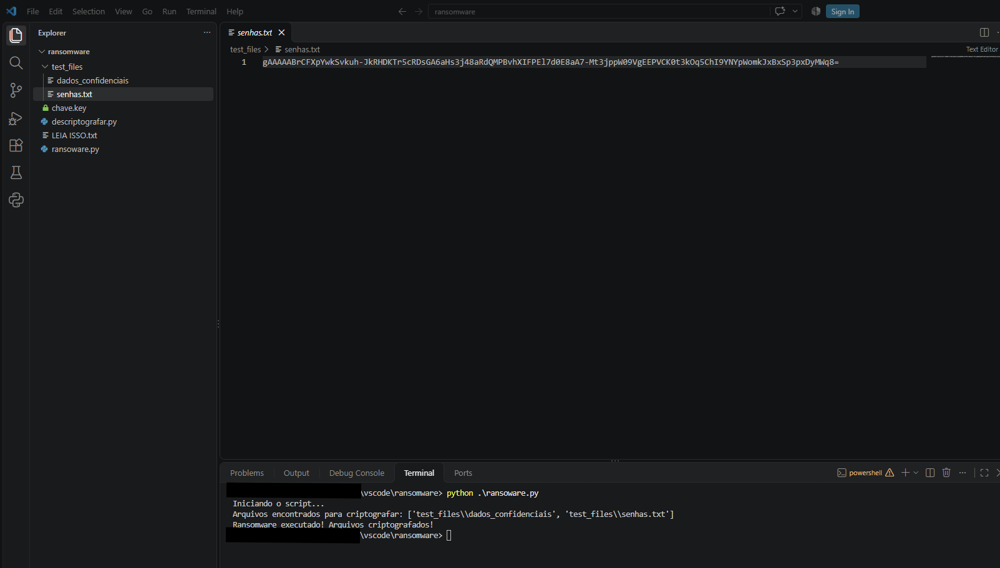
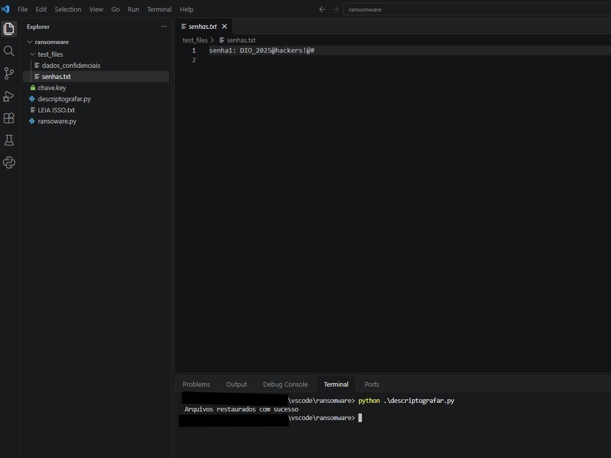
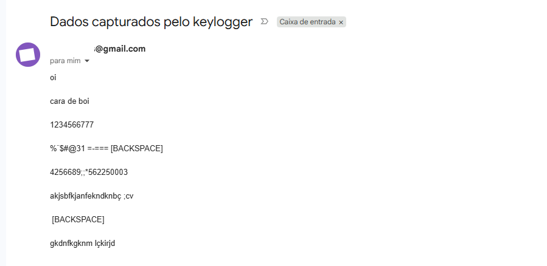

# 🛡️ Laboratório de Criptografia e Monitoramento em Python: Análise Prática de Ransomware e Keylogger

## 📌 Sobre o Projeto
Este repositório foi desenvolvido como parte de um desafio prático de cibersegurança com fins **100% educacionais e de pesquisa**. O objetivo deste laboratório é compreender os mecanismos técnicos utilizados por agentes maliciosos no desenvolvimento de *malwares* (Ransomware e Keylogger) em um ambiente controlado, permitindo o estudo aprofundado de assinaturas heurísticas, vetores de ataque e engenharia de mitigação defensiva.

---

## 🏗️ Estrutura do Repositório
```text
├── images/                   # Capturas de tela demonstrando o funcionamento dos testes
├── keylogger/
│   ├── keylogger.pyw         # Script de monitoramento local silencioso (gera log.txt em segundo plano)
│   ├── keylogger_email.py    # Script de monitoramento assíncrono com exfiltração via SMTP
├── ransomware/
│   ├── ransomware.py        # Script de criptografia simétrica em massa
│   ├── descriptografar.py   # Script de reversão e recuperação de arquivos
│   └── test_files/          # Diretório isolado com arquivos de teste
└── README.md                # Documentação técnica do projeto
```

---

## 🛠️ Detalhamento Técnico das Implementações

### 1. Ransomware Simulado
O módulo de ransomware demonstra o impacto da perda de confidencialidade e integridade através do sequestro de dados baseado em criptografia simétrica.
* **Algoritmo Utilizado:** Biblioteca `cryptography` com criptografia simétrica `Fernet` (baseada em AES-128 em modo CBC com HMAC-SHA256).
* **Mapeamento Dinâmico:** Uso da biblioteca `os.walk` para varrer diretórios específicos (`test_files`), garantindo uma lista de alvos dinâmica e ignorando arquivos críticos e extensões `.key` para evitar corrupção do próprio código.
* **Persistência:** Geração de uma chave simétrica local (`chave.key`) e escrita automatizada de um arquivo de instrução de resgate (`LEIA ISSO.txt`).
* **Módulo de Descriptografia:** Desenvolvimento de uma ferramenta inversa para ler o vetor de inicialização/chave e restaurar o estado original dos bits dos arquivos afetados.

### 2. Keylogger Local Oculto (`keylogger.pyw`)
Antes da implementação do módulo de rede, foi desenvolvido um protótipo focado em persistência local e furtividade de execução.
* **Execução Silenciosa (`.pyw`):** Utiliza a extensão nativa do Python para Windows que desvincula o processo do console do sistema (`pythonw.exe`). Quando disparado, o script não abre janelas de terminal, rodando inteiramente como um processo de segundo plano invisível ao usuário comum.
* **Escrita Incremental em Disco:** As teclas capturadas são processadas e injetadas de forma assíncrona diretamente no arquivo local `log.txt` utilizando o modo de abertura `"a"` (append), o que garante baixíssimo consumo de memória e evita a perda de dados caso o processo seja encerrado abruptamente.

### 3. Keylogger com Exfiltração via E-mail (`keylogger_email.py`)
Evolução do módulo anterior, adicionando inteligência de rede para envio remoto de logs.
* **Mecanismo de Escuta:** Utilização da biblioteca `pynput.keyboard` em uma arquitetura orientada a eventos para capturar chaves virtuais estruturadas.
* **Robustez e Tratamento de Exceções:** Implementação de regras para mapeamento do teclado numérico lateral (*Numpad* via códigos `vk`), tratamento de valores nulos (`None`) gerados por caracteres acentuados no padrão ABNT2 e tratamento para teclas de controle (Espaço, Enter, Backspace).
* **Exfiltração Assíncrona:** Integração com o protocolo `SMTP` (via `smtplib` e `MIMEText`) utilizando conexões seguras TLS sobre a porta 587. Os relatórios de memória são limpos e despachados periodicamente a cada 60 segundos por meio de execução paralela controlada pela classe `threading.Timer`.

---

## 📸 Demonstração Visual dos Testes

### Execução do Ransomware e Criptografia


### Restauração de Dados com o Descriptografador


### Recebimento dos Logs do Keylogger via SMTP


---

## 🔬 Crônica dos Testes e Desafios Superados (Análise de Ambiente)
Durante o desenvolvimento do laboratório, foram identificados e mitigados dois grandes desafios comuns na engenharia de software de segurança:
1. **Conflito de Variáveis de Ambiente (PATH):** O terminal inicialmente não reconhecia os interpretadores locais do Python devido a aliases do Windows Store ativos. Foi realizada a reinstalação limpa com o mapeamento correto do executável no PATH do Windows e a desativação manual dos Aliases nativos.
2. **Heurística do Windows Defender (Bloqueio EDR):** O antivírus nativo barrou a execução do código de criptografia, limpando o conteúdo do arquivo e gerando erros de permissão (`[Errno 22]` e arquivos zerados com `Length: 0`). O comportamento foi contornado através da criação de uma política de exclusão de diretório nas configurações de proteção contra vírus e ameaças do sistema operacional, simulando uma técnica de evasão controlada em ambiente de testes.

---

## 🛡️ Reflexão sobre Defesa, Mitigação e Prevenção
O estudo prático dessas ameaças evidencia que a proteção eficaz depende de uma estratégia de **Defesa em Profundidade (Defense in Depth)**. No mundo real, mitigamos esses ataques através de:

### Tecnologias de Proteção Avançada
* **Endpoint Detection and Response (EDR / Antivírus):** Soluções modernas não dependem apenas de assinaturas estáticas de arquivos, mas analisam comportamentos suspeitos em tempo real (como um script varrendo o disco com `os.walk` ou capturando ganchos globais do teclado) e bloqueiam o processo imediatamente, como testemunhado neste laboratório antes da configuração da exclusão.
* **Firewall de Próxima Geração (NGFW):** Bloqueio de tráfego de rede anômalo, impedindo que conexões SMTP não autorizadas ou servidores de Comando e Controle (C2) externos recebam dados vazados.
* **Sandboxing:** Execução de arquivos suspeitos obtidos por e-mail ou internet em ambientes virtuais isolados antes que tenham acesso ao sistema operacional principal do usuário.

### Políticas Operacionais e Consciência Humana
* **Políticas de Backup (Regra 3-2-1):** A defesa definitiva contra ransomwares consiste em manter 3 cópias de dados em 2 mídias diferentes, sendo pelo menos 1 delas totalmente *offline* (fora da rede). Caso a criptografia ocorra, o sistema é restaurado sem necessidade de negociação.
* **Security Awareness (Conscientização do Usuário):** A engenharia social continua sendo o maior vetor de entrega de malwares. Treinar colaboradores para identificar e-mails de *phishing*, não baixar anexos suspeitos e não desativar edições de antivírus por conta própria constitui o elo mais forte da segurança.

---

## ⚖️ Declaração de Isenção de Responsabilidade (Disclaimer)
Este projeto foi desenvolvido estritamente para fins educacionais, em conformidade com as diretrizes do curso Bootcamp. Os códigos aqui presentes foram testados em um laboratório isolado de minha propriedade. O uso dessas técnicas fora de ambientes de teste autorizados sem o consentimento explícito por escrito do proprietário do ativo é estritamente proibido por lei (como a Lei Carolina Dieckmann no Brasil e legislações internacionais de crimes cibernéticos).
